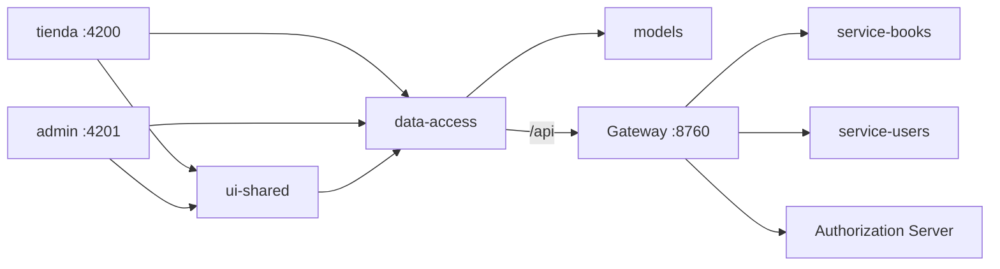

# Libreria Frontend

Workspace Angular 22 (standalone, signals y Signal Forms) con las aplicaciones web de la librería digital. Consume los microservicios del repositorio [Libreria](https://github.com/CesarVelascoAriza/Libreria) a través del Gateway.

Versión actual: **1.0.0** (visible en el pie de ambas aplicaciones; se toma de `package.json`).

## Arquitectura



## Proyectos

| Proyecto | Tipo | Descripción |
|---|---|---|
| `tienda` | Aplicación | Catálogo de libros con búsqueda y filtro por categoría |
| `admin` | Aplicación | CRUD de libros y gestión de usuarios (requiere `ROLE_ADMIN`) |
| `data-access` | Librería | Servicios HTTP, autenticación, interceptor y guards |
| `models` | Librería | Interfaces TypeScript equivalentes a las entidades del backend |
| `ui-shared` | Librería | Componentes y estilos globales compartidos (login) |

Las librerías se importan por alias (`data-access`, `models`, `ui-shared`) definidos en `tsconfig.json`.

## Conexión con el backend

| Recurso | Endpoint (vía Gateway) | Microservicio |
|---|---|---|
| Login / logout | `POST /api/auth/login`, `POST /api/auth/logout` | Authorization Server |
| Libros | `/api/books` | service-books |
| Usuarios (lectura / borrado) | `GET, DELETE /api/users` | service-users |
| Usuarios (alta / edición) | `POST, PUT /api/users` | Authorization Server (cifra la clave) |

En desarrollo `proxy.conf.json` redirige `/api` a `http://localhost:8760`, por lo que no se requiere CORS. En producción, sirve la app detrás del mismo dominio del Gateway o reemplaza el token `API_URL`.

> `service-factura` aún no tiene endpoints y no está conectado.

## Autenticación

1. `AuthService.login()` obtiene el JWT y lo guarda en `localStorage` y en un signal.
2. `authInterceptor` agrega `Authorization: Bearer <token>`; ante un `401` limpia la sesión y redirige a `/login`.
3. `authGuard` protege la tienda y `adminGuard` exige el rol `ROLE_ADMIN` presente en el claim `roles` del token.

## Requisitos

- Node.js 22+ y npm 11
- Backend levantado (Eureka, Gateway, Authorization Server, service-books y service-users)

## Comandos

```bash
npm install
npm run start:tienda   # http://localhost:4200
npm run start:admin    # http://localhost:4201
npm run start:all      # ambas aplicaciones
npm run build          # compila todos los proyectos
npm test               # pruebas unitarias (Vitest)
ng test data-access    # pruebas de un proyecto concreto
```

## Estructura

```
projects/
├── tienda/        # app pública
├── admin/         # app de administración
├── data-access/   # LibrosService, UsuariosService, AuthService, interceptor, guards
├── models/        # Book, Categoria, Usuario, Rol, auth
└── ui-shared/     # Login y estilos globales (_global.scss)
proxy.conf.json    # proxy de desarrollo hacia el Gateway
```

## Convenciones

- Componentes standalone, `inject()` y estado con `signal` / `computed`.
- Datos remotos con `httpResource`; formularios con Signal Forms (`@angular/forms/signals`).
- Estilos: `tienda` usa Less y `admin` usa Sass; los comunes viven en `ui-shared`.

## Flujo de ramas (GitFlow)

| Rama | Uso |
|---|---|
| `master` | Código en producción, solo recibe `release/*` y `hotfix/*` |
| `develop` | Integración de desarrollo |
| `feature/*` | Nuevas funcionalidades, salen de y vuelven a `develop` |
| `release/x.y.z` | Preparación de versión, alineada con las del backend |
| `hotfix/*` | Correcciones urgentes sobre `master` |
